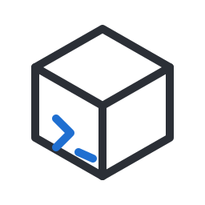

<p align="center">
  <picture>
    <source media="(prefers-color-scheme: dark)" srcset="docs/logo-dark.svg">
    
  </picture>
</p>

<h1 align="center">CADprompt</h1>

<p align="center"><b>Say what to build. Watch FreeCAD build it.</b><br>
A chat panel in FreeCAD, for a local model, an API key or a signed-in AI account.
Linux, macOS and Windows.</p>

> **Status: test version 0.2.** It works on Linux with FreeCAD 1.1.4. Windows and
> macOS are written for but not yet tested by a person. Read "What is not done yet"
> before you give it to a class.

## Install

In FreeCAD, no command line:

1. **Edit → Preferences → Addon Manager Options**.
2. Under **Custom repositories** press **+**.
   Repository URL: `https://github.com/mechanicsunlocked/cadprompt`  Branch: `freecad-addon`
   (the test branch; it will be `main` after the tests on Windows and macOS)
3. Close the preferences, open **Tools → Addon manager**, search **CADprompt**, install.
4. Restart FreeCAD.

Updates come the same way: the Addon Manager shows them.

## First start

Pick the **CADprompt** workbench in FreeCAD's workbench list. The chat panel opens
on the right and stays open when you go to another workbench. A new installation
has no AI: the panel shows three buttons, **Local model**, **API key** and
**Claude account**. Nothing is contacted, and no login or key of your computer is
used, before you choose one. You can change the choice later in **Settings**:

| Source | You need | What leaves the computer |
|---|---|---|
| **Local model** | a model server that speaks the OpenAI API: LM Studio, Ollama, llama.cpp. On this computer or on another one in your network. Nothing else. | nothing, when the server is on this computer; else to that server |
| **Anthropic API key** | a key from the Anthropic Console. Nothing else. | your messages, the images that you send with them, and what the tools report (the objects of your model, the output of the code, text files of the project that the AI reads): to `api.anthropic.com`, billed per use |
| **Claude account** | the Claude Code program, signed in. Nothing else. | your messages, the project files that Claude reads, what the tools report, and a picture of the 3D view when Claude asks for one: to Anthropic, on your subscription |

**Local model, step by step.** In Settings choose "Local model or other server",
type the server address (LM Studio: `http://127.0.0.1:1234/v1`, Ollama:
`http://127.0.0.1:11434/v1`), press **Find models**, pick one, OK.
For a classroom: run one model server on a computer in the room and let the
students type its address, for example `http://192.168.1.20:1234/v1`.

**API key, step by step.** In Settings choose "Anthropic API key", paste the
key, OK. The model is `claude-opus-5-5` until you pick another one: **Find
models** asks Anthropic which models your key can use.

**Claude account, step by step.** Install Claude Code, run `claude` one time in
a terminal and sign in. In Settings choose "Claude account". The panel starts
Claude Code for each message; you do not need the terminal again.

The local model and the API key share one conversation in a project. You can
change between them in the middle of the work.

**CADprompt asks before data leaves your computer.** The first time you use a
service that is not on this computer (a model server on another computer, the
Anthropic API, Claude Code), a window in FreeCAD names the service and says
what is sent. **Allow** is kept for that service; **Not now** sends nothing.
A model server on this computer needs no question. **Settings → Privacy**
lists the services that you allowed, with a **Forget** button for each. Forget
works at once: Claude Code is stopped when it is at work for that service.

## Using it

- **Project**: a folder with `model/`, `refs/` and `drawings/`. Pick one or make a
  new one at the top of the panel.
- **Build / Teach**: Build makes the whole part. Teach goes one feature at a time
  and says which tool a person would use and why.
- **Add reference…**, or drop a photo, a PDF or a link on the panel: it goes into
  `refs/` for the AI. With a local model or an API key, an image (PNG, JPEG) also
  goes with your next message, at most 4 for each message, made smaller to
  1568 pixels. Only the picture is sent, not the text that the file holds about
  its author, camera or place. The model must be able to read images; if it
  cannot, the panel tells you and you can send the message again without them.
- **Drawing**: a workshop drawing on an ISO sheet (A4 to A2): three views, an
  isometric view, the overall dimensions, the title block, and a PDF in
  `drawings/`. The sheet is made by fixed rules, not by the AI. Tolerances,
  surface marks and detail dimensions you add yourself.
- **Check**: the AI reviews the model before it goes to the shop.
- **Run or Skip**: when the AI wants to run code, the panel shows the code and
  waits. When the code is longer or wider than its box, a line under it says so:
  scroll to read all of it. **Run** runs exactly that text. **Skip** runs nothing
  and tells the AI that you did not approve the step. The question never takes
  the keyboard: what you type goes into the message box. After a click on the
  code, Enter is Run and Esc is Skip. **Run all for this
  request** runs the next steps of this one request without a question. A
  drawing asks the same way, with one line that says what will be made. Tools
  that only look (the list of objects, a file of the project) do not ask. The
  chat keeps every piece of code that ran, folded: press "show" to read it.
- **Run the AI's code without asking** (Settings): off in a new installation.
  When you turn it on, a warning tells you what that means. While it is on,
  the panel shows the marker "runs without asking"; one click on the marker
  turns it off again.
- **Undo**: each step of the AI is one Undo step in FreeCAD. Before the first
  change of a request, the model file is copied to `model/.backup/`. A request
  that ends with an error is not saved over your file.

The **Drawing** toolbar of the workbench has the Hoischen tools for TechDraw
(DIN preset, dimension lines at 10 mm and 7 mm): see [docs/hoischen.md](docs/hoischen.md).

## Safety and privacy, the honest version

- **The AI writes Python and FreeCAD runs it, as you.** You see the code first
  and press Run, unless you turned "Run the AI's code without asking" on. A
  guard refuses the plain ways to start programs, use the network or delete
  files, and one run is stopped after 60 seconds. That guard is a fence, not a
  wall. Read the code, and work on models that you can restore.
- **A small local model makes mistakes.** It can build a wrong part and say that
  it is right. The panel finds broken objects and takes such a step back, but it
  cannot see a hole in the wrong place. Check the part.
- **Keys** are files in FreeCAD's user data folder (`cadprompt_api_key`,
  `cadprompt_local_key`, `cadprompt_endpoint_token`), not in FreeCAD's settings.
  On Linux and macOS only you can read them (mode 0600). Windows has no such
  modes: there the files are in your own user folder, which other users of the
  computer cannot open. A key is sent only to the server it was saved for. The
  Anthropic key always goes over https. The key of a model server goes the way
  the address of that server says: with an address that starts with `http://`
  the connection is not encrypted. For a server on this computer that is no
  problem. For a server on another computer (the classroom server), other
  people on the same network can read the key and the conversation, and the
  question before the first request says so. An address that you type without
  `http://` or `https://` gets https when a key is saved, unless the server is
  this computer.
- **The chat shows text only.** A picture that an answer or a stored
  conversation names is not loaded: the text of the AI cannot make FreeCAD open
  a file or a network address. A link opens in your browser, and only a web
  link (http, https).
- **Nothing is sent to an AI service until you send a message or press Find
  models, and never before you said Allow to that service.** With the Claude
  account source, the panel asks the Claude Code program on this computer
  whether you are signed in (`claude auth status`), but only after you allowed
  Claude Code. No telemetry. Your yes is kept in FreeCAD's settings for the
  service (its kind and its host name) and for the kinds of data that this
  version sends. CADprompt asks again when the host changes, when a later
  version sends another kind of data, and when the address of a server that you
  allowed with `https://` changes to `http://`.
- **A key that is in the environment of your computer** (`ANTHROPIC_API_KEY`
  and the like) is never used by CADprompt. For Claude Code, CADprompt takes
  out of the environment every variable that gives it a key, a login or
  another address, or that sends it to another provider than the one you
  allowed (the names that start with `ANTHROPIC_` and `CLAUDE_CODE_USE_`, for
  example `CLAUDE_CODE_USE_BEDROCK`). The variables that only choose a model
  (`ANTHROPIC_MODEL`, `ANTHROPIC_DEFAULT_..._MODEL`) stay. A provider that is
  set in Claude Code's own settings file is not changed by CADprompt.
- With the API key source, each step of a request is one HTTPS request to
  `api.anthropic.com`: the conversation of the project (up to about 300,000
  characters of it), the images of that conversation and the key. Find models is
  one more request with the key. Nothing else is contacted, except the proxy of
  your computer when its settings name one (next point).
- When the settings of the computer name a proxy, CADprompt uses it for https,
  as a browser does: the proxy learns the name of the service
  (`api.anthropic.com`) and passes encrypted data that it cannot read. The key
  and the conversation stay inside that encryption. A login for the proxy that
  is part of the setting goes to the proxy only. If the proxy does not answer,
  CADprompt connects directly. A model server with an `http://` address is
  never reached through a proxy, and a model server on this computer is never
  reached through a proxy at all.
- With the Claude account source, Claude Code is a program of its own, and it
  must reach FreeCAD. For that, CADprompt opens a small server inside FreeCAD
  (the Model Context Protocol, over HTTP). The server listens only on this
  computer (`127.0.0.1`), on a port that the system picks. Each request needs a
  token that is made new for each start and is kept in memory only; the panel
  gives it to the Claude Code program that it starts. A web page cannot use the
  server: a request from a browser is refused. The server starts when you send
  a message to Claude and have allowed Claude Code, not when FreeCAD starts.
  It stops when you close the panel, choose a local model or an API key, take
  your yes for Claude Code back, or quit FreeCAD.
- Claude Code gets four tools from that server: `run_python`,
  `get_document_state`, `make_drawing` and `get_view`. Claude Code started by
  the panel cannot show a question of its own, so the question is asked in
  FreeCAD: `run_python` and `make_drawing` wait for your Run or Skip in the
  panel, exactly as with a local model. The two tools that only look do not
  ask. CADprompt starts Claude Code with the shell tool off and in its asking
  mode: its own file tools (Write, Edit) are refused in the panel; it can read
  the files of the project. Claude Code waits for your answer for up to one
  day (`"timeout"` in the `.mcp.json` of the addon).
- **A project folder from another person** cannot give Claude Code other
  tools. CADprompt tells Claude Code to use the server list of the addon and
  no other, so a `.mcp.json` in the project folder is not read by the panel.
  A project with hooks (commands that Claude Code runs by itself, in
  `.claude/settings.json`, `.claude/settings.local.json` or in the head of a
  command file) is not started: the panel names the file. CADprompt also tells
  Claude Code not to count a "trust this folder" answer that it stored for the
  folder. Its `CLAUDE.md` is read: look at it before you send a message in a
  project that is not yours.
- The tools work in the document that was active when you sent the message,
  also when you click another document while Claude works. After Stop, after
  New chat, and after Claude Code has ended, the server runs no more tool calls
  until your next message. When Claude Code gives a tool call up while its
  question waits for you, the question closes and the step is not run.
- If your computer uses a proxy (`HTTP_PROXY`, `HTTPS_PROXY`), CADprompt adds
  `127.0.0.1` and `localhost` to `NO_PROXY` for Claude Code, so the requests to
  FreeCAD stay on this computer.

### Every connection that CADprompt can make

| Connection | When | What is sent | What must be true first |
|---|---|---|---|
| To the model server of the source "Local model" (`POST <address>/chat/completions`) | once for each step of the AI after you send a message | the conversation of the project: your messages, the results of the AI's code, descriptions of the document (object names, sizes), the images that you attached, the text of project files that the AI read; the key of that server when you saved one | a server on this computer: nothing. Another computer: your Allow for that host |
| To the same server (`GET <address>/models`) | when you press Find models | the key of that server when you saved one | the same |
| To `api.anthropic.com` (`POST /v1/messages`), source "Anthropic API key" | once for each step of the AI after you send a message | the same conversation data, and your API key | your Allow for Anthropic |
| To `api.anthropic.com` (`GET /v1/models`) | when you press Find models | your API key | your Allow for Anthropic |
| To the proxy of your computer, when its settings name one | before each https connection above to another computer | the name of the service (`CONNECT api.anthropic.com:443`), and the login for the proxy when the setting has one | the same Allow as for the connection |
| The program `claude auth status` (it is started; CADprompt itself connects to nothing) | when the panel opens or the settings change, with a Claude Code source | nothing from CADprompt | your Allow for Claude Code |
| The program `claude -p` (Claude Code; it sends the data to Anthropic or to your endpoint with its own connections) | once for each message | your message; through the tools: the results of the AI's code, descriptions of the document, pictures of the 3D view; and the project files that Claude Code reads | your Allow for Claude Code with that service |
| The server inside FreeCAD for Claude Code (`127.0.0.1`, incoming only) | listens from your first message to Claude until the panel closes | nothing leaves the computer | your Allow for Claude Code; each request needs the token |

CADprompt makes no other connection: no update check, no telemetry, no
download. FreeCAD's Addon Manager, not CADprompt, gets the updates.

## What is not done yet

- Claude Code is a program of its own. CADprompt asks you before it starts it,
  but it cannot see or limit the connections that Claude Code makes.
- The text of the `CLAUDE.md` and of the command files of a project folder is
  read by Claude Code. Look at them in a project that is not yours.
- Keys are files that only you can read, not entries in the key store of the
  system.
- No person has tested Windows and macOS.
- A fine-tuned small model for FreeCAD is planned.

## Projects from an older version

The first test versions needed the `uv` program and the FreeCADMCP addon for the
Claude account source. It needs neither now.

- When you send the first message to Claude in a project that an older
  CADprompt made, the files that came from the template (`.mcp.json`,
  `CLAUDE.md`, the commands, the settings of Claude Code) are replaced by the
  new ones, and the old ones stay beside them as `<name>.old`. The panel names
  the files. This happens only for a file that you never changed. A file that
  you changed is left alone, and the panel tells you what to do. With a local
  model or an API key nothing is replaced.
- The older terminal launcher works with the old files. To use it again for
  such a project, put the `.old` files back.
- CADprompt does not remove the FreeCADMCP addon. If you do not use it for other
  things, remove it in the Addon Manager: as long as it is installed, it opens
  its own port when FreeCAD starts.

## For developers

`python3 tests/run_all.py` runs all tests in a throw-away FreeCAD profile
(see [tests/README.md](tests/README.md)).

```
cadprompt/    the chat panel, the engines, the drawing tool
hoischen/     DIN helpers for TechDraw (LGPL-2.1-or-later)
template/     copied into every new project
tests/        run_all.py and the test files
```

The older Omarchy launcher (hotkeys, bar menu, `setup`) is at the tag
`omarchy-launcher`.

## Licence

MIT for CADprompt ([LICENSE](LICENSE)). The Hoischen tools in `hoischen/` are
LGPL-2.1-or-later ([hoischen/LICENSE](hoischen/LICENSE)).
